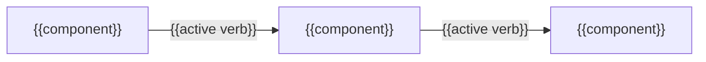
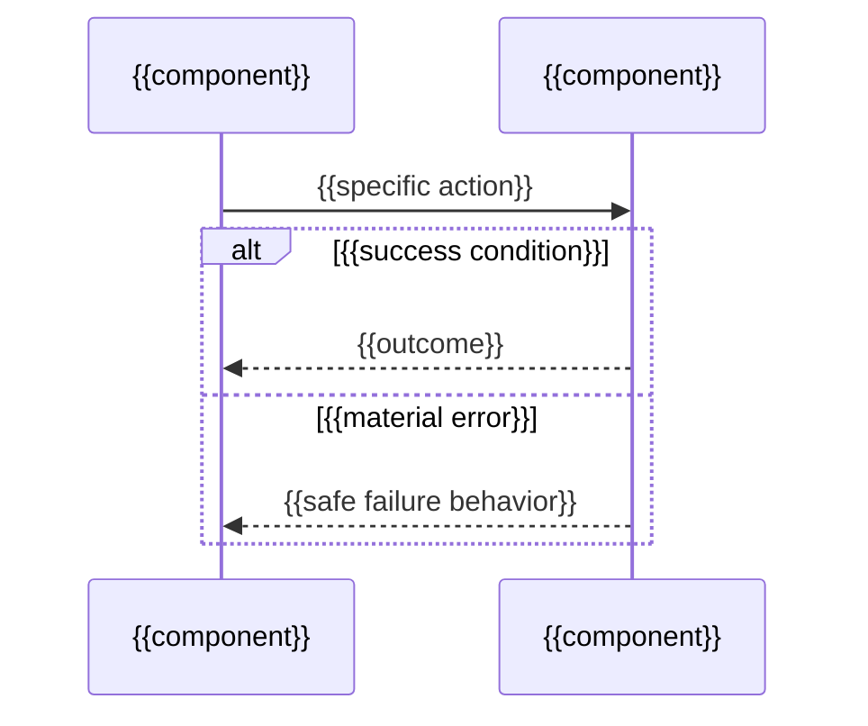
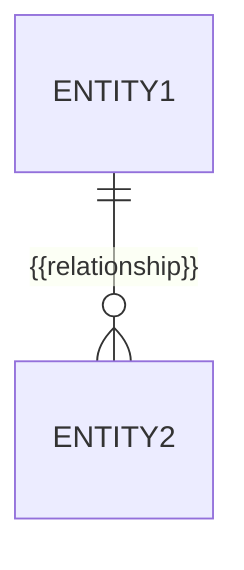

# {{Subsystem title}}

_Last reviewed: {{YYYY-MM-DD}}_

<!-- L0 — the answer. See ../../../references/progressive-disclosure.md and the
deep-dive frame in ../../../references/deep-dive-frame.md. -->

**In one sentence:** {{what this subsystem owns and where its responsibility ends}}

{{One paragraph: the parent high-level block this subsystem decomposes, and the
architectural decisions this decomposition supports. Name the decision or
review a reader comes here to make — never lead with mechanism.}}

## Responsibility

{{What this subsystem does and the boundary it owns. State non-responsibilities
explicitly: what a neighbor owns that a reader might assume lives here.}}

## Components

<!-- L1 — the shape: name every component before explaining any one. -->

_Repeat per component material to this subsystem's boundary — not an exhaustive
file listing._

| Component | Responsibility | Public contract | Talks to |
|---|---|---|---|
| {{component}} | {{what it does and the boundary it owns}} | `{{signature or protocol}}` | {{component — active verb and protocol when evidenced}} |

{{One or two sentences: what the grouping reveals about responsibility, and
which dependency direction the design deliberately forbids. Omit the diagram
only when the subsystem holds fewer than three components.}}

### {{Component name}}

**Responsibility:** {{what it does and the boundary it owns.}}

**Public contract:** `{{signature or protocol}}`

- **Talks to:** -> {{component}} — {{specific active verb and protocol when evidenced}}
- **Owns:** {{the data or responsibility that is exclusively its}}
- **Invariant:** {{what is deliberately absent or always enforced}}
- **Failure boundary:** {{what this component contains when it fails}}
- **Key paths:** `{{stable file/module path(s)}}`

## Boundary

{{Inputs, outputs, public contracts, and adjacent systems. What enters and
leaves this subsystem, and the neighboring subsystem or external system on
the other side of each contract.}}

## Runtime scenarios

_Repeat per architecturally significant scenario — one to three, never one per
code path. Each must include a successful outcome and a material error branch._

### {{Significant path}}

{{Why this scenario matters and its successful outcome. Every message maps to a
named component above.}}

{{One or two sentences restating the order and the failure branch in prose, so
the scenario survives without the diagram.}}

## Data and state

{{State/data/transaction/consistency behavior when applicable: what state this
subsystem owns, what transitions it allows, and what consistency model holds
across entities that are not atomic together. Delete this section when the
subsystem holds no state.}}

{{One or two sentences: which relationship constrains the subsystem, and which
entity owns the write path. Omit the diagram when no persistent model exists.}}

## Failure and recovery

{{Failure containment, retry, rollback, degradation, and escalation boundaries:
what can fail, where the failure is contained, what recovers automatically, and
where control hands to operations or another owner.}}

## Observability

{{Signals and operational handoff: what an operator watches, and where the
operational runbook or observability owner takes over.}}

## Security and trust

{{Security/trust implications when the subsystem crosses a boundary: what
crosses the boundary in each direction, what trust decision is being relied on,
and where the security owner documents the control. Omit when the subsystem
crosses no trust boundary.}}

## Quality and change scenarios

{{The load, latency, or volume ceiling this subsystem was built to hold, and the
modification it was shaped to absorb cheaply — each stated as a scenario with
evidence: a configured limit, a benchmark, a load test, an extension point.
Delete this whole section when the repository evidences neither a quality
ceiling nor an anticipated change; never estimate a figure.}}

## Where it lives

{{Stable implementation locations that orient implementation work.}}

## Unknowns and open risks

{{What is not yet known, and links to the owning specialized documents for
excluded detail. State a gap as an evidence gap rather than padding a section.}}
